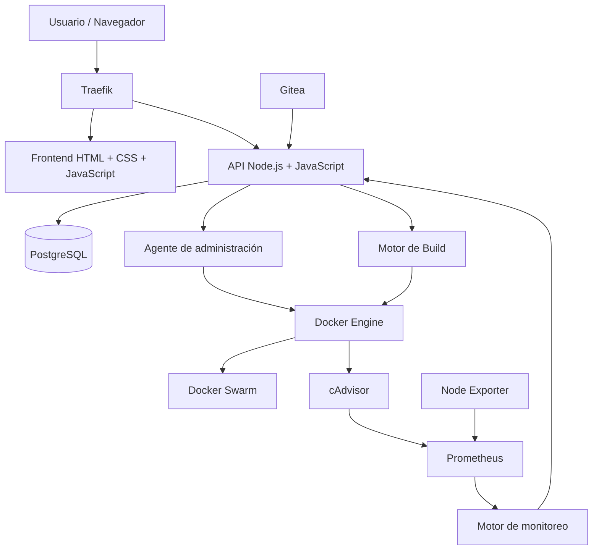

# VPS Manager
## Plataforma propia de instalación, administración y despliegue de infraestructura Docker Swarm

**Estado:** Implementación incremental; primera fase funcional en desarrollo  
**Versión:** 1.0  
**Sistema operativo objetivo:** Ubuntu Server 24.04 LTS  
**Arquitectura:** Docker Swarm de un solo nodo  
**Tipo de proyecto:** Plataforma self-hosted de administración de servidores, aplicaciones y proyectos web.

> **Estado de implementación:** el panel incluye autenticación de administrador, consulta de solo lectura de datos del servidor, contenedores, servicios y stacks Docker, métricas históricas de CPU/RAM con retención de siete días en PostgreSQL, alertas operativas, un registro interno de auditoría, respaldos cifrados de PostgreSQL y comprobación de releases públicas de GitHub para actualizar VPS Manager manualmente desde el VPS. Las demás funciones de esta especificación (agente de escritura, tareas persistentes, proyectos Git, catálogo, roles, etc.) siguen pendientes y no se consideran instaladas.

---

# 1. Descripción general

VPS Manager será una plataforma de administración de infraestructura que permitirá instalar, configurar, desplegar, monitorear y administrar todos los servicios de un VPS desde una interfaz web centralizada.

El objetivo es que un servidor Ubuntu recién instalado pueda convertirse, mediante un único comando, en un entorno completo de administración de infraestructura.

Una vez instalado, el usuario accederá a un dashboard web desde el cual podrá:

- Administrar Docker y Docker Swarm.
- Consultar todos los contenedores, servicios y stacks.
- Instalar aplicaciones desde un catálogo.
- Administrar proyectos web mediante repositorios Git privados.
- Configurar despliegues automáticos al recibir nuevos commits.
- Seleccionar la rama de producción de cada proyecto.
- Configurar dominios y certificados SSL.
- Administrar variables de entorno y secretos.
- Consultar el consumo de recursos por contenedor, aplicación y proyecto.
- Administrar redes, volúmenes e imágenes.
- Consultar logs y estados de ejecución.
- Gestionar backups y restauraciones.
- Detectar servicios instalados manualmente.
- Reiniciar, actualizar y administrar servicios.
- Recuperar automáticamente servicios después de reiniciar el servidor.

La plataforma debe funcionar de forma independiente de servicios externos como GitHub, GitLab o proveedores de despliegue.

## 1.1. Filosofía del proyecto

El sistema debe cumplir cuatro principios:

1. **Centralización:** todas las operaciones de administración deben poder realizarse desde un único panel.
2. **Automatización:** las instalaciones y despliegues deben requerir la menor intervención manual posible.
3. **Compatibilidad:** debe poder detectar y administrar servicios creados tanto por la plataforma como manualmente.
4. **Persistencia:** las aplicaciones, configuraciones y datos deben sobrevivir a reinicios y actualizaciones.

La plataforma no debe convertirse en una implementación propia de Docker. Debe aprovechar Docker Engine y Swarm como motores de ejecución.

---

# 2. Arquitectura general

## 2.1. Diagrama de componentes



## 2.2. Componentes principales

| Componente | Tecnología | Responsabilidad |
|---|---|---|
| Sistema operativo | Ubuntu 24.04 LTS | Sistema base |
| Instalador | Bash | Preparación automatizada del VPS |
| Proxy inverso | Traefik | Dominios y HTTPS |
| Frontend | HTML, CSS y JavaScript nativo | Dashboard sin proceso de compilación |
| Backend | Node.js con módulos JavaScript (`.mjs`) | API y lógica de negocio |
| Base de datos | PostgreSQL | Persistencia de información |
| Git privado | Gitea | Repositorios |
| Contenedores | Docker Engine | Ejecución |
| Orquestación | Docker Swarm | Administración de servicios |
| Build | Docker BuildKit | Construcción de imágenes |
| Monitoreo | Prometheus | Almacenamiento de métricas |
| Métricas de contenedores | cAdvisor | CPU, RAM y red |
| Métricas del servidor | Node Exporter | Recursos generales |
| Logs | Docker Engine y sistema propio | Consulta e historial |
| Backups | `pg_dump`/`pg_restore` y AES-256-GCM | Respaldo cifrado y restauración de PostgreSQL del panel |

## 2.3. Separación de responsabilidades

El sistema tendrá cuatro capas:

**Frontend**
- Mostrar información.
- Recibir configuraciones.
- Mostrar estados y resultados.
- Solicitar operaciones a la API.

**Backend**
- Validar solicitudes.
- Gestionar usuarios y permisos.
- Mantener la base de datos.
- Coordinar instalaciones y despliegues.
- Administrar las tareas.
- Consultar métricas y logs.

**Agente de administración**
- Ejecutar operaciones permitidas sobre Docker.
- Consultar el estado del servidor.
- Ejecutar operaciones de infraestructura.
- Gestionar despliegues.
- Evitar que la API exponga directamente un acceso irrestricto al socket Docker.

**Infraestructura**
- Ejecutar contenedores.
- Administrar servicios y stacks.
- Mantener redes y volúmenes.
- Ejecutar aplicaciones.

El agente tendrá una interfaz interna restringida, autenticada y con operaciones permitidas explícitamente. No debe aceptar comandos arbitrarios enviados por el navegador.

---

# 3. Instalador automático del VPS

## 3.1. Objetivo

Crear un instalador que convierta una instalación limpia de Ubuntu Server 24.04 LTS en un servidor completamente funcional.

El usuario debe poder ejecutar un solo comando para iniciar la instalación.

Ejemplo de interfaz:

```bash
curl -fsSL https://dominio-del-proyecto/install.sh | sudo bash
```

En producción, el instalador debe utilizar una versión publicada y verificada mediante checksum o firma. No debe ejecutar código remoto sin mecanismos de verificación.

### Estado actual del instalador

El repositorio incluye `install.sh`, `installer/stack.yml`, `installer/diagnostics.sh` e `installer/uninstall.sh`, además del panel inicial en `apps/manager/`.

El instalador:

- Solo admite Ubuntu Server 24.04 LTS en `amd64` o `arm64`.
- Instala Docker Engine desde el repositorio APT oficial e inicializa Swarm de un nodo si hace falta.
- Despliega el panel y Traefik con HTTPS de Let's Encrypt.
- Espera a que los servicios estén activos y valida el certificado HTTPS y el endpoint de salud.
- Requiere un dominio con DNS configurado y los puertos TCP 80/443 disponibles y permitidos en el firewall del VPS y del proveedor.
- Incluye un modo temporal de prueba por IPv4 privada y HTTP, sin dominio, correo ni certificado TLS.
- Usa Traefik 3.7.17, cuyo cliente Docker actualizado negocia una API compatible con versiones actuales de Docker Engine.
- Pide una contraseña administrativa de al menos 16 caracteres; la guarda como secreto Swarm con hash scrypt, no como texto plano.
- Consulta por defecto las releases públicas de `self-david/baco-vps-visor`; se puede cambiar con `VPS_MANAGER_GITHUB_REPOSITORY=owner/repo`.
- No configura ni altera UFW ni reglas externas. Es responsabilidad del administrador permitir TCP 80/443 en el firewall del VPS y del proveedor.
- Conserva los secretos y los volúmenes (Traefik y PostgreSQL) durante la desinstalación normal.

El panel inicial solo consulta contenedores, servicios y stacks; permite buscar por nombre, imagen o ID y filtrar por estado, modo o cantidad de servicios, además de consultar logs recientes y métricas actuales e históricas de CPU/RAM por contenedor, agrupadas por stack/proyecto. El muestreo es configurable y los datos se conservan siete días. No ofrece acciones de escritura sobre Docker. El socket se accede mediante `docker-socket-proxy` con operaciones de escritura desactivadas. Traefik y el panel requieren las consultas de lectura autorizadas para servicios, tareas y nodos de Swarm. Solo el proxy monta el socket; la API del panel no lo monta y el proxy no publica puertos al host. PostgreSQL solo escucha en la red interna del stack; su contraseña se guarda como secreto Swarm y sus datos en un volumen persistente.

#### Prueba en una red privada

El modo de prueba publica el panel por HTTP y desactiva el atributo `Secure` de la cookie de sesión para que el inicio de sesión funcione sin TLS. La contraseña y la sesión viajan sin cifrar: úsalo únicamente en una red privada y nunca expongas el puerto 80 a Internet.

Desde la raíz del checkout en Ubuntu 24.04, indica la IPv4 privada del VPS:

```bash
sudo env VPS_MANAGER_TEST_MODE=true VPS_MANAGER_DOMAIN=192.168.100.158 bash install.sh
```

La instalación verifica `http://192.168.100.158/api/health` y muestra la URL del panel. Reemplaza la IP de ejemplo por la del servidor.

Si el checkout está en Windows, ejecuta desde PowerShell, en la raíz del proyecto:

```powershell
.\deploy-test.ps1
```

El script prepara una copia temporal del proyecto, excluye `.git`, `node_modules` y `password-test.txt`, la sube por SCP a un directorio único y elimina los temporales al terminar. Después normaliza los finales de línea de los scripts Bash y ejecuta la instalación por SSH con terminal interactiva. Solicitará la contraseña SSH y `sudo` según corresponda, además de la contraseña administrativa del panel. No guardes contraseñas en el script.

#### Instalación con dominio y HTTPS

Desde la raíz del checkout en Ubuntu 24.04, ejecuta:

```bash
sudo bash install.sh
```

El instalador solicitará dominio, correo de Let's Encrypt y contraseña usando el terminal (`/dev/tty`), aunque el propio script llegue por una tubería `curl | sudo bash`. Para uso no interactivo se pueden definir `VPS_MANAGER_DOMAIN`, `VPS_MANAGER_EMAIL`, `VPS_MANAGER_ADMIN_PASSWORD` y, si la detección automática de red no aplica, `VPS_MANAGER_ADVERTISE_ADDR`. Nunca pases la contraseña como argumento de línea de comandos.

Diagnóstico, actualización y desinstalación:

```bash
sudo vps-manager-diagnostics
sudo vps-manager-update
sudo vps-manager-reset-password
sudo vps-manager-uninstall
```

El panel incluye **Diagnóstico del sistema**, una comprobación bajo demanda de Docker Engine, Swarm, réplicas de los servicios del stack, redes, conexión PostgreSQL y disponibilidad de archivos de respaldo cifrados. No realiza cambios. Los detalles del host que requieren acceso al sistema operativo (Ubuntu, memoria, espacio de disco y puertos) siguen disponibles con `sudo vps-manager-diagnostics` por SSH; el panel conserva el acceso Docker de solo lectura y no recibe privilegios de host.

La comprobación de actualizaciones consulta `GET /repos/{owner}/{repo}/releases/latest` de la API pública de GitHub. Solo considera tags estables `vMAJOR.MINOR.PATCH`; el panel compara esa versión con la versión instalada y muestra las notas y el enlace a la release. Cuando hay una actualización utilizable, el panel permite copiar `sudo vps-manager-update`. La acción no se ejecuta en el navegador: el administrador debe abrir una sesión SSH y ejecutar el comando. Así se conserva el proxy Docker de solo lectura y la API web no recibe privilegios de escritura sobre Swarm.

El comando del VPS obtiene la última release estable y requiere que tenga el asset `vps-manager-source.tar.gz` con un digest SHA-256 publicado por GitHub. Verifica ese digest, valida las rutas del archivo y que `apps/manager/VERSION` coincida con el tag antes de ejecutar el instalador. Antes de actualizar crea un respaldo cifrado de PostgreSQL con la clave Swarm ya configurada; después reconstruye la imagen, despliega la nueva versión y valida el endpoint de salud. Ante un fallo intenta solicitar a Swarm rollback del servicio manager. PostgreSQL y los volúmenes/secretos persistentes no se eliminan.

La release debe ser pública y publicarse mediante el workflow `.github/workflows/release.yml`, que exige un tag estable `vX.Y.Z` igual al contenido de `apps/manager/VERSION` y adjunta el archivo fuente al release de GitHub. El proyecto ya está configurado para `self-david/baco-vps-visor`; durante la instalación se guarda ese repositorio en `/opt/vps-manager/install.env`. El instalador descarga el tag inicial `v0.1.0`. Si todavía no hay tags ni releases, publica primero `v0.1.0`; después, los tags/releases posteriores habilitarán la detección y actualización.

##### Crear y publicar una release desde PowerShell

Desde la raíz del repositorio, indica solo la versión nueva:

```powershell
.\publish-release.ps1 0.1.2
```

El script comprueba que la rama sea `main`, que el árbol de trabajo esté limpio, que la versión sea válida y superior a las versiones existentes, y que el tag no esté ya publicado. Si `apps/manager/VERSION` todavía tiene una versión menor, la actualiza y crea un commit; si ya coincide con la versión indicada, conserva el commit existente. Luego sube `main`, crea el tag anotado `v<versión>` y lo publica. Después, GitHub Actions valida que el tag coincida con `VERSION` y genera la release con `vps-manager-source.tar.gz`; confirma que el workflow terminó correctamente en la pestaña **Actions**. No reutilices tags, incluso si un workflow de release anterior falló.

El comando de cambio de contraseña solicita y confirma una nueva contraseña de al menos 16 caracteres. Actualiza el secreto Swarm y reinicia el servicio del panel; no modifica el secreto de sesión ni los datos persistentes.

Desde Windows, puedes copiar e instalar el comando de recuperación y cambiar la contraseña en una sola operación desde PowerShell, en la raíz del proyecto:

```powershell
.\reset-test-password.ps1
```

Para pruebas, también puedes guardar la nueva contraseña en un archivo de texto de una sola línea (mínimo 16 caracteres) y pasar su ruta:

```powershell
.\reset-test-password.ps1 -PasswordFile .\password-test.txt
```

El archivo se transfiere por SCP dentro de un directorio temporal con acceso restringido, se elimina del VPS al terminar y no se borra del equipo local. Este modo evita el ingreso interactivo, pero el archivo local contiene la contraseña en texto plano: no lo subas al repositorio, no lo compartas y elimínalo después de la prueba. No uses este método para producción.

La desinstalación conserva los secretos y los datos persistentes de Traefik y PostgreSQL. `--purge-secrets` elimina las credenciales de administrador y la clave de sesión; no borra la contraseña ni el volumen de PostgreSQL, para no dejar la base inaccesible.

#### Publicación para el comando `curl`

El repositorio predeterminado es `https://github.com/self-david/baco-vps-visor.git`. Para habilitar una instalación remota estable con `curl`, primero publica el tag inicial y aloja `install.sh`:

1. Crea y publica el tag `v0.1.0`, cuyo archivo `apps/manager/VERSION` debe contener `0.1.0`.
2. Publica el `install.sh` de ese tag en la ruta `https://mipagina.com/install.sh`.
3. Configura el DNS del dominio del panel y permite TCP 80/443 para el modo de producción.

El servidor remoto descarga el código desde el repositorio configurado; alojar solo `install.sh` no basta. Después de completar esos pasos, los usuarios podrán ejecutar:

```bash
curl -fsSL https://mipagina.com/install.sh | sudo bash
```

Ese patrón confía en el contenido servido por HTTPS. Para producción, publica una release firmada y verifica el instalador antes de ejecutarlo; el instalador actual todavía no verifica una firma criptográfica de release.

## 3.2. Requisitos previos

- Ubuntu Server 24.04 LTS de 64 bits.
- Acceso SSH.
- Usuario con permisos sudo.
- Conexión a Internet.
- Para producción: dominio con DNS apuntando al VPS y puertos 80/443 disponibles.
- Para pruebas: IPv4 privada del VPS y puerto 80 disponible; no se requiere dominio ni correo.

El instalador debe verificar los requisitos antes de realizar modificaciones.

## 3.3. Proceso de instalación

### Etapa 1: diagnóstico

- Detectar versión de Ubuntu.
- Detectar arquitectura.
- Comprobar memoria y almacenamiento.
- Comprobar puertos ocupados.
- Detectar instalaciones previas de Docker.
- Detectar servicios incompatibles.
- Comprobar conectividad.

### Etapa 2: preparación

- Actualizar paquetes.
- Instalar dependencias.
- Configurar zona horaria.
- Crear usuario o grupo administrativo específico.
- Preparar directorios.

### Etapa 3: Docker

- Instalar Docker Engine desde el repositorio oficial.
- Instalar Docker CLI.
- Instalar Docker Buildx.
- Configurar Docker como servicio systemd.
- Habilitar inicio automático.
- Inicializar Docker Swarm en modo single-node.

### Etapa 4: infraestructura incluida en esta primera entrega

- Crear redes necesarias.
- Desplegar Traefik y certificados HTTPS.
- Desplegar un proxy Docker con operaciones de escritura deshabilitadas.

### Etapa 5: plataforma incluida en esta primera entrega

- Desplegar el panel mínimo con su API de solo lectura.
- Desplegar PostgreSQL interno en una red overlay cifrada, sin publicarlo.
- Configurar autenticación inicial y comunicación interna.

Gitea, Prometheus, cAdvisor, Node Exporter, PostgreSQL de catálogo y las capacidades de despliegue de proyectos se implementarán en fases posteriores. El PostgreSQL interno del panel ya forma parte de esta entrega.

### Etapa 6: finalización

- Verificar servicios.
- Verificar conectividad.
- Verificar certificados.
- Comprobar acceso al dashboard.
- Guardar reporte de instalación.
- Mostrar URL y datos iniciales de acceso.

## 3.4. Reglas del instalador

El instalador debe ser:

- Idempotente cuando sea posible.
- Capaz de detectar instalaciones previas.
- Seguro ante interrupciones.
- Capaz de registrar errores.
- Capaz de reanudar etapas cuando sea viable.
- Compatible con actualizaciones futuras.

No debe eliminar automáticamente configuraciones o datos preexistentes.

Debe incluir un modo de diagnóstico y un procedimiento de desinstalación que preserve los volúmenes de datos por defecto.

---

# 4. Dashboard

## 4.1. Objetivo

El dashboard será el punto central de administración.

Debe proporcionar una vista general del estado del servidor y acceso a todos los módulos.

## 4.2. Pantallas principales

### Dashboard general

Mostrar:

- Estado del VPS.
- CPU total.
- Memoria RAM utilizada y disponible.
- Almacenamiento.
- Tráfico de red.
- Contenedores activos.
- Contenedores detenidos.
- Servicios con errores.
- Aplicaciones instaladas.
- Proyectos desplegados.
- Últimas operaciones.
- Alertas importantes.

### Proyectos

Administración de aplicaciones desarrolladas por el usuario y alojadas en Git.

### Aplicaciones

Catálogo de aplicaciones instalables.

### Contenedores

Vista global de contenedores Docker.

### Servicios

Administración de servicios Swarm.

### Stacks

Administración de conjuntos de servicios.

### Dominios

Gestión de dominios, subdominios y certificados.

### Redes

Consulta y administración de redes Docker.

### Volúmenes

Consulta y administración de almacenamiento persistente.

### Imágenes

Consulta de imágenes Docker instaladas y utilizadas.

### Monitoreo

Métricas históricas y consumo individual.

### Logs

Consulta de registros de aplicaciones y operaciones.

### Backups

Administración de respaldos y restauraciones.

### Configuración

Configuración general del VPS Manager.

---

# 5. Sistema de proyectos

Este es uno de los módulos principales.

Permitirá desplegar proyectos propios alojados en repositorios Git privados dentro del mismo VPS.

## 5.1. Integración Git

Utilizar Gitea como servidor Git autohospedado.

Características:

- Crear repositorios privados.
- Administrar usuarios.
- Administrar permisos.
- Administrar ramas.
- Consultar commits.
- Consultar historial.
- Utilizar SSH para operaciones Git.
- Integrar webhooks.
- Administrar llaves SSH.

El usuario no necesitará GitHub ni GitLab.

## 5.2. Registro de proyectos

Cada proyecto debe tener:

- Nombre.
- Descripción.
- Repositorio.
- Rama de despliegue.
- Tipo de proyecto.
- Método de construcción.
- Dockerfile o configuración de build.
- Dominio.
- Puerto interno.
- Variables de entorno.
- Redes.
- Volúmenes.
- Política de reinicio.
- Configuración de salud.
- Recursos asignados.
- Estado.
- Historial de despliegues.

## 5.3. Selección de rama

Cada proyecto tendrá una rama de producción independiente.

Ejemplo:

```text
Proyecto: OwnMind

Repositorio:
git@servidor:proyectos/ownmind.git

Rama de producción:
main

Dominio:
app.ejemplo.com

Puerto:
4321

Deploy automático:
Activado
```

El sistema debe permitir cambiar la rama de producción sin modificar el repositorio.

También debe permitir seleccionar una rama diferente para un despliegue manual.

## 5.4. Flujo de despliegue automático

El usuario desarrollará localmente y enviará cambios al VPS.

Ejemplo:

```bash
git add .
git commit -m "Actualización"
git push production main
```

Proceso:

1. Gitea recibe el push.
2. Gitea notifica al backend mediante un webhook autenticado.
3. El backend valida el repositorio y la rama.
4. Comprueba que el proyecto tenga despliegue automático habilitado.
5. Registra una tarea de despliegue.
6. Obtiene el commit correspondiente.
7. Construye una imagen Docker.
8. Identifica la imagen con el commit.
9. Valida la configuración de Swarm.
10. Despliega la nueva versión.
11. Comprueba el estado del servicio.
12. Registra el resultado.
13. Notifica el éxito o error.

Si el push corresponde a una rama distinta de la configurada, no debe desplegar producción.

Los webhooks deben validar su autenticidad y evitar ejecuciones duplicadas.

## 5.5. Construcción de proyectos

Soportar inicialmente:

- Dockerfile.
- Dockerfile con ruta personalizada.
- Aplicaciones Node.js.
- Aplicaciones Astro.
- Aplicaciones React.
- Aplicaciones estáticas.
- Aplicaciones con múltiples servicios mediante definición Swarm.

La plataforma no debe asumir que todos los proyectos utilizan el mismo framework.

El usuario debe poder definir:

- Directorio de trabajo.
- Dockerfile.
- Build arguments.
- Puerto interno.
- Comando de inicio, cuando corresponda.
- Variables de entorno.
- Volúmenes.
- Recursos.

## 5.6. Versiones y rollback

Cada despliegue debe conservar:

- Identificador del commit.
- Rama.
- Imagen generada.
- Fecha.
- Estado.
- Logs de construcción.
- Logs de despliegue.

Las imágenes deben identificarse por commit, no solamente por `latest`.

Debe existir una opción para regresar a una imagen anterior.

El rollback debe permitir recuperar la configuración de despliegue asociada a esa versión, sin sobrescribir las variables actuales de forma involuntaria.

## 5.7. Historial de despliegues

Mostrar:

- Proyecto.
- Commit.
- Rama.
- Fecha.
- Duración.
- Usuario o evento que inició el despliegue.
- Resultado.
- Logs.
- Acción de rollback.

---

# 6. Catálogo de aplicaciones

## 6.1. Objetivo

Permitir instalar aplicaciones completas sin escribir manualmente sus configuraciones Docker.

Cada aplicación tendrá una plantilla de instalación.

## 6.2. Aplicaciones iniciales

### Automatización
- n8n.

### Backend e infraestructura
- Supabase.
- PostgreSQL.
- Redis.
- MinIO (opcional; almacenamiento de objetos compatible con S3).

### Monitoreo
- Grafana.
- Prometheus.
- cAdvisor.
- Node Exporter.

### Administración
- Gitea.

El catálogo debe poder ampliarse sin modificar el código principal del panel.

## 6.3. Configuración de aplicaciones

Cada instalación debe solicitar los datos necesarios:

- Nombre de la instalación.
- Dominio.
- Variables de entorno.
- Credenciales.
- Puertos.
- Redes.
- Volúmenes.
- Recursos.
- Configuración de salud.

Las plantillas deben tener versiones.

## 6.4. Aplicaciones multicontenedor

Algunas aplicaciones, como Supabase, están compuestas por varios servicios.

El sistema debe poder:

- Instalar todos los servicios relacionados.
- Agruparlos bajo una aplicación.
- Administrar sus dependencias.
- Consultar su consumo individual.
- Mostrar el consumo total.
- Actualizar sus componentes.
- Mantener sus volúmenes persistentes.

No se debe considerar una aplicación multicontenedor como un único contenedor.

## 6.5. Instalaciones personalizadas

Permitir instalar stacks propios a partir de configuraciones compatibles con Docker Swarm.

El sistema debe validar las configuraciones antes de desplegarlas.

---

# 7. Administración de Docker y Swarm

## 7.1. Descubrimiento

La plataforma debe consultar Docker Engine y detectar:

- Contenedores.
- Servicios.
- Stacks.
- Redes.
- Volúmenes.
- Imágenes.

Debe incluir recursos que fueron creados fuera del panel.

## 7.2. Clasificación

Cada recurso debe tener un origen:

- Administrado por VPS Manager.
- Detectado externamente.
- Adoptado por VPS Manager.

La adopción debe ser explícita.

El sistema debe guardar información sobre el estado original de cada recurso antes de modificarlo.

## 7.3. Operaciones sobre contenedores

- Consultar.
- Iniciar.
- Detener.
- Reiniciar.
- Inspeccionar.
- Consultar logs.
- Consultar estadísticas.
- Consultar variables disponibles sin exponer secretos.
- Consultar puertos.
- Consultar redes.

## 7.4. Operaciones sobre servicios Swarm

- Consultar.
- Escalar réplicas.
- Actualizar imagen.
- Forzar actualización.
- Consultar tareas.
- Consultar estado.
- Consultar logs.
- Actualizar configuración.
- Eliminar con confirmación.

En un Swarm de un solo nodo, las operaciones de escalado deben respetar los recursos disponibles.

## 7.5. Recursos externos

No asumir que todos los contenedores pueden convertirse automáticamente en stacks administrables.

Para recursos externos:

- Permitir inspección.
- Permitir operaciones compatibles.
- Permitir importar configuraciones cuando sea posible.
- Advertir cuando una operación pueda perder información.
- No eliminar volúmenes automáticamente.

---

# 8. Dominios y certificados SSL

Utilizar Traefik como proxy inverso.

## 8.1. Funciones

- Registrar dominios.
- Asociar dominios a proyectos.
- Asociar dominios a aplicaciones.
- Configurar puertos internos.
- Configurar HTTPS.
- Gestionar certificados.
- Renovar certificados.
- Consultar errores de emisión.
- Administrar redirecciones.
- Configurar subdominios.

## 8.2. Ejemplo

```text
panel.ejemplo.com
    -> VPS Manager

git.ejemplo.com
    -> Gitea

n8n.ejemplo.com
    -> n8n

app.ejemplo.com
    -> Proyecto web

db.ejemplo.com
    -> No publicar por defecto
```

No se deben exponer servicios administrativos o bases de datos directamente a Internet sin una configuración explícita y controles adicionales.

## 8.3. Validaciones

Antes de crear un dominio:

- Comprobar configuración.
- Comprobar puerto interno.
- Comprobar servicio.
- Comprobar conflictos.
- Comprobar que el dominio resuelve al servidor cuando sea necesario.

La emisión de certificados requiere que el DNS y los puertos correspondientes estén configurados correctamente.

---

# 9. Variables de entorno y secretos

Cada proyecto y aplicación debe disponer de su propio sistema de configuración.

## 9.1. Variables

Ejemplo:

```env
DATABASE_URL=...
API_KEY=...
JWT_SECRET=...
PUBLIC_URL=https://app.ejemplo.com
```

Permitir:

- Agregar variables.
- Editar variables.
- Eliminar variables.
- Importar archivos `.env`.
- Aplicar cambios.
- Consultar historial de cambios.

## 9.2. Seguridad

Los secretos no deben:

- Aparecer en logs.
- Ser enviados al frontend después de guardarse.
- Guardarse en texto plano en la base de datos.
- Incluirse en imágenes Docker.
- Exponerse en errores.

Utilizar Docker Secrets para credenciales que deban entregarse a servicios Swarm.

Para secretos de aplicaciones que no puedan consumir Docker Secrets, utilizar almacenamiento cifrado y archivos temporales protegidos.

## 9.3. Aplicación de cambios

Modificar una variable no debe cambiar silenciosamente un servicio.

El usuario debe poder:

1. Guardar cambios.
2. Revisar los cambios pendientes.
3. Aplicar configuración.
4. Reiniciar o actualizar el servicio cuando corresponda.

---

# 10. Monitoreo y consumo de recursos

Este módulo permitirá conocer cuánto consume cada contenedor, aplicación, proyecto y el servidor completo.

## 10.1. Métricas

### CPU
- Porcentaje de utilización.
- Consumo por contenedor.
- Consumo por aplicación.
- Consumo total.
- Histórico.

### RAM
- Memoria utilizada.
- Memoria disponible.
- Límite configurado.
- Porcentaje utilizado.
- Histórico.

### Almacenamiento
- Uso del disco del VPS.
- Espacio disponible.
- Tamaño de imágenes.
- Tamaño de volúmenes.
- Consumo por aplicación cuando pueda atribuirse de forma confiable.

### Red
- Tráfico entrante.
- Tráfico saliente.
- Bytes transmitidos.
- Bytes recibidos.
- Consumo por contenedor.

## 10.2. Agrupación

Ejemplo:

```text
Aplicación: Supabase

  Database
    CPU: 5%
    RAM: 1.2 GB

  Auth
    CPU: 2%
    RAM: 350 MB

  Storage
    CPU: 1%
    RAM: 200 MB

  REST
    CPU: 3%
    RAM: 450 MB

  Total:
    CPU: 11%
    RAM: 2.2 GB
```

Los valores anteriores son ilustrativos.

El sistema debe asociar contenedores a aplicaciones mediante identificadores y etiquetas consistentes.

## 10.3. Tecnologías

- cAdvisor: métricas de contenedores.
- Prometheus: recolección e histórico.
- Node Exporter: recursos generales del VPS.

Grafana puede utilizarse para desarrollo y diagnóstico, pero el dashboard propio debe presentar las métricas principales mediante su propia interfaz.

## 10.4. Intervalos e históricos

Configurar:

- Recolección periódica.
- Visualización en tiempo real aproximado.
- Histórico de corto plazo.
- Histórico de largo plazo configurable.
- Retención de datos.

El sistema debe evitar un consumo excesivo de almacenamiento por métricas.

## 10.5. Alertas

Permitir configurar alertas por:

- CPU elevada.
- RAM crítica.
- Disco casi lleno.
- Servicio detenido.
- Servicio sin respuesta.
- Reinicios repetidos.
- Error de despliegue.
- Certificado próximo a expirar.

El panel implementa alertas internas para CPU/RAM, espacio libre en el filesystem visible al contenedor del panel, réplicas de servicios Swarm por debajo de lo deseado y reinicios repetidos. También comprueba las rutas `Host(...)` definidas en las etiquetas Traefik de los servicios Swarm: realiza un `GET /`, considera sanas las respuestas 2xx/3xx y alerta ante otros estados, error de conexión o timeout. Para rutas HTTPS inspecciona el certificado presentado y alerta cuando vence dentro de los días configurados; un certificado no disponible también genera alerta TLS. Las alertas de despliegue reportan servicios Swarm con actualización pausada o rollback, y tareas recientes fallidas/rechazadas en una ventana de 15 minutos. El detalle de error se limita a 240 caracteres. Los valores iniciales son CPU 90%, RAM 90%, disco libre 10%, 3 reinicios en 60 minutos, timeout HTTP 5 segundos y aviso TLS 14 días antes. Son configurables desde el dashboard. CPU/RAM requieren superar el umbral en dos muestras consecutivas. La detección de reinicios compara los contadores de Docker entre muestras periódicas y se activa después de registrar al menos dos muestras del contenedor. El disco se mide desde `statfs("/")` dentro del contenedor del panel, no por cada filesystem del host. Estas alertas no envían email ni webhooks.

---

# 11. Persistencia y recuperación

## 11.1. Reinicio del VPS

Después de reiniciar Ubuntu:

- Docker debe arrancar automáticamente.
- Swarm debe recuperar su estado.
- Los servicios con políticas de reinicio deben volver a ejecutarse.
- Traefik debe recuperar el enrutamiento.
- El panel debe volver a estar disponible.
- La base de datos debe conservar sus datos.
- Gitea debe conservar sus repositorios.
- Prometheus debe conservar sus métricas según la retención configurada.

## 11.2. Políticas de reinicio

Los servicios administrados deben tener políticas apropiadas de reinicio.

No todos los servicios deben recibir la misma política sin considerar su naturaleza.

## 11.3. Healthchecks

Cada aplicación debe definir comprobaciones de salud cuando sea posible.

Debe distinguirse entre:

- Proceso detenido.
- Contenedor activo.
- Contenedor unhealthy.
- Aplicación sin respuesta.
- Servicio recuperándose.

Un healthcheck que informa `unhealthy` no garantiza que Swarm reinicie el contenedor.

Se deberá implementar un mecanismo controlado de recuperación para aplicaciones que no respondan.

Este mecanismo debe:

- Detectar fallos.
- Evitar ciclos de reinicio.
- Aplicar límites de intentos.
- Registrar cada recuperación.
- Generar alertas cuando no pueda recuperarse.

## 11.4. Backups

Respaldar:

- Base de datos del panel.
- Repositorios Git.
- Volúmenes de aplicaciones.
- Configuración de Traefik.
- Configuración de stacks.
- Configuración del VPS Manager.
- Secretos y claves necesarios para restauración, protegidos adecuadamente.

Los backups deben permitir restaurar el servidor en otro VPS.

No considerar un backup completo una simple copia de archivos mientras los servicios están escribiendo datos. Utilizar procedimientos consistentes con cada base de datos y aplicación.

### Implementación disponible

La versión actual respalda únicamente la base PostgreSQL de VPS Manager mediante `pg_dump` en formato custom. El stream se cifra con AES-256-GCM antes de guardarse en `/var/lib/vps-manager/backups`; un archivo se publica solo después de completar el dump. El panel permite iniciar respaldos manuales, programa el primero 24 horas después de arrancar el servicio y permite ajustar el intervalo entre 1 y 168 horas. La retención fija es de siete días.

La instalación crea una clave aleatoria de 256 bits como secreto Swarm y la muestra una sola vez. Debe guardarse fuera del VPS en un gestor de secretos o almacenamiento seguro: no se incluye en el directorio de respaldos. Sin esa clave no es posible verificar ni restaurar los archivos. La desinstalación normal conserva el secreto y los respaldos; `--purge-secrets` exige una confirmación adicional y elimina la clave, por lo que vuelve irrecuperables los respaldos existentes.

La restauración requiere escribir `RESTAURAR`, valida la autenticidad AES-GCM antes de invocar `pg_restore` y reemplaza dentro de una transacción los objetos incluidos en el respaldo. Los objetos que no existían al crear el respaldo no forman parte del archivo. Esta función no es un backup completo del VPS: no incluye volúmenes de aplicaciones, secretos adicionales, configuración de stacks, certificados Traefik ni recuperación a otro servidor.

## 11.5. Auditoría operativa

El panel muestra al administrador los últimos 100 eventos de cambios en ajustes de métricas y respaldos: creación manual o programada, cambio de intervalo y restauración. Las actualizaciones de configuración y su evento de auditoría se guardan en la misma transacción de PostgreSQL. Las operaciones de archivos (crear/restaurar respaldo) se registran al finalizar, por lo que un fallo al guardar el evento se informa por separado y no implica que la operación ya realizada se haya revertido. No se registran contraseñas ni claves.

El registro es historial operativo interno, no un almacenamiento inmutable o resistente a un administrador con acceso a PostgreSQL; tampoco incluye todavía inicios de sesión, accesos fallidos ni cambios de infraestructura Docker.

---

# 12. Sistema de tareas y operaciones

Las instalaciones y despliegues pueden tardar varios minutos.

Por eso el backend debe tener un sistema de tareas persistentes.

## 12.1. Tipos de tareas

- Instalación.
- Desinstalación.
- Despliegue.
- Build.
- Actualización.
- Rollback.
- Reinicio.
- Backup.
- Restauración.
- Configuración de dominio.
- Actualización del sistema.

## 12.2. Estados

```text
pending
running
success
failed
cancelled
```

## 12.3. Requisitos

Cada tarea debe registrar:

- Identificador.
- Usuario.
- Tipo.
- Recurso relacionado.
- Fecha de inicio.
- Fecha de finalización.
- Estado.
- Progreso cuando sea posible.
- Logs.
- Mensaje de error.

Las tareas deben sobrevivir a reinicios del backend.

Las operaciones críticas deben ser idempotentes o disponer de mecanismos para detectar si ya fueron ejecutadas.

Debe evitarse ejecutar simultáneamente dos despliegues incompatibles del mismo proyecto.

---

# 13. Seguridad

La seguridad es un requisito fundamental porque el sistema administrará el servidor completo.

## 13.1. Autenticación

- Usuario administrador inicial.
- Contraseñas almacenadas mediante hashing seguro.
- Sesiones protegidas.
- Cierre de sesión.
- Recuperación de acceso.
- Protección contra fuerza bruta.
- Posibilidad de habilitar MFA.

## 13.2. Autorización

Preparar roles:

- Administrador.
- Operador.
- Solo lectura.

Los permisos deben aplicarse tanto en el frontend como en el backend.

## 13.3. Docker

El acceso al motor Docker equivale prácticamente a privilegios administrativos sobre el host.

Por ello:

- No exponer Docker API por TCP sin protección.
- No permitir comandos arbitrarios desde el navegador.
- No montar el socket Docker en el frontend.
- Utilizar un agente restringido.
- Validar las operaciones.
- Registrar acciones sensibles.

## 13.4. Red

- Firewall configurado.
- SSH protegido.
- Exponer solamente puertos necesarios.
- Separar redes internas y públicas.
- No publicar bases de datos sin necesidad.
- HTTPS obligatorio para el panel.
- Autenticación de webhooks.

## 13.5. Auditoría

Registrar:

- Inicio de sesión.
- Instalaciones.
- Eliminaciones.
- Modificaciones.
- Despliegues.
- Rollbacks.
- Cambios de secretos.
- Acciones administrativas.

---

# 14. Estructura del repositorio

Propuesta inicial:

```text
vps-manager/
│
├── README.md
├── LICENSE
├── .gitignore
│
├── installer/
│   ├── install.sh
│   ├── uninstall.sh
│   ├── update.sh
│   ├── diagnostics.sh
│   └── modules/
│       ├── system.sh
│       ├── docker.sh
│       ├── swarm.sh
│       ├── firewall.sh
│       ├── directories.sh
│       ├── networking.sh
│       ├── traefik.sh
│       ├── database.sh
│       ├── monitoring.sh
│       └── application.sh
│
├── apps/
│   ├── frontend/
│   │   ├── src/
│   │   ├── public/
│   │   └── package.json
│   │
│   ├── backend/
│   │   ├── src/
│   │   │   ├── modules/
│   │   │   ├── services/
│   │   │   ├── routes/
│   │   │   ├── middleware/
│   │   │   └── database/
│   │   └── package.json
│   │
│   └── agent/
│       ├── src/
│       └── package.json
│
├── packages/
│   ├── shared/
│   └── schemas/
│
├── catalog/
│   ├── applications/
│   │   ├── n8n/
│   │   ├── supabase/
│   │   ├── postgres/
│   │   ├── redis/
│   │   └── minio/
│   │
│   └── schemas/
│
├── infrastructure/
│   ├── traefik/
│   ├── monitoring/
│   ├── database/
│   └── stacks/
│
├── database/
│   ├── migrations/
│   └── seeds/
│
├── tests/
│   ├── unit/
│   ├── integration/
│   ├── installer/
│   ├── deployment/
│   └── recovery/
│
└── docs/
    ├── architecture.md
    ├── installation.md
    ├── security.md
    ├── deployment.md
    ├── monitoring.md
    ├── backups.md
    └── development.md
```

Esta estructura es una propuesta inicial. El proyecto prioriza JavaScript nativo y evita un paso de compilación mientras no aporte un beneficio concreto.

---

# 15. Modelo de datos

Utilizar PostgreSQL.

Entidades principales:

| Tabla | Responsabilidad |
|---|---|
| users | Usuarios |
| roles | Roles |
| permissions | Permisos |
| sessions | Sesiones |
| projects | Proyectos |
| git_repositories | Repositorios |
| project_branches | Ramas |
| deployments | Despliegues |
| deployment_logs | Logs de despliegue |
| applications | Aplicaciones instaladas |
| application_templates | Plantillas |
| services | Servicios Docker |
| containers | Contenedores detectados |
| stacks | Stacks Swarm |
| domains | Dominios |
| environment_variables | Variables de entorno |
| secrets | Referencias a secretos |
| networks | Redes |
| volumes | Volúmenes |
| images | Imágenes |
| resource_metrics | Métricas |
| tasks | Tareas |
| backups | Respaldos |
| alerts | Alertas |
| audit_logs | Auditoría |
| server_settings | Configuración general |

## 15.1. Relaciones importantes

- Un proyecto puede tener varios despliegues.
- Un proyecto puede tener varios dominios.
- Un proyecto puede tener varias variables.
- Una aplicación puede contener varios servicios.
- Un stack puede contener varios servicios.
- Un servicio puede generar varios contenedores a lo largo del tiempo.
- Una aplicación puede agrupar varios servicios.
- Un despliegue pertenece a un proyecto.
- Una tarea puede relacionarse con cualquier recurso administrado.

Los secretos deben almacenarse fuera de las columnas convencionales de variables y con controles de acceso propios.

---

# 16. API

El backend debe ofrecer una API organizada por módulos.

Rutas orientativas:

## Autenticación

```text
POST /api/auth/login
POST /api/auth/logout
GET  /api/auth/session
```

## Dashboard

```text
GET /api/dashboard
GET /api/dashboard/resources
GET /api/dashboard/activity
```

## Proyectos

```text
GET    /api/projects
POST   /api/projects
GET    /api/projects/:id
PATCH  /api/projects/:id
DELETE /api/projects/:id
POST   /api/projects/:id/deploy
POST   /api/projects/:id/rollback
GET    /api/projects/:id/deployments
```

## Git

```text
GET  /api/git/repositories
GET  /api/git/repositories/:id/branches
POST /api/git/webhooks/:projectId
POST /api/webhooks/gitea
```

## Aplicaciones

```text
GET    /api/applications/catalog
GET    /api/applications
POST   /api/applications/install
GET    /api/applications/:id
PATCH  /api/applications/:id
POST   /api/applications/:id/update
DELETE /api/applications/:id
```

## Docker

```text
GET  /api/docker/containers
GET  /api/docker/services
GET  /api/docker/info
GET  /api/docker/stacks
GET  /api/docker/container-metrics
GET  /api/docker/containers/:id/logs
GET  /api/docker/services/:id/logs
GET  /api/docker/networks
GET  /api/docker/volumes
GET  /api/docker/images
POST /api/docker/containers/:id/restart
POST /api/docker/containers/:id/stop
POST /api/docker/containers/:id/start
```

## Métricas e histórico

```text
GET   /api/system/metrics-settings
PATCH /api/system/metrics-settings
GET   /api/system/metrics-history
GET   /api/system/metric-alerts
```

La frecuencia de muestreo se configura en minutos (1–1440) y se guarda en PostgreSQL; el valor inicial es 15. Las muestras se recogen automáticamente y también al solicitar CPU/RAM. El panel muestra las últimas 24 horas y elimina datos con más de 7 días. Los umbrales de CPU por contenedor (1–10000%), RAM respecto al límite del contenedor (1–100%), disco libre (1–99%), y reinicios (1–100 en una ventana de 5–1440 minutos) se editan en el panel. CPU/RAM se activan al superar el umbral en dos muestras consecutivas; disco alerta al llegar o bajar del umbral, los servicios cuando hay menos tareas activas que las deseadas y reinicios al alcanzar el conteo dentro de la ventana. Las alertas son internas al panel y se actualizan automáticamente cada minuto mientras está abierto. El espacio en disco se obtiene con `statfs("/")` desde el contenedor del panel; no representa por separado otros puntos de montaje del VPS.

Las rutas web se descubren de las reglas `Host(...)` en las etiquetas de routers Traefik de los servicios Swarm; no se aceptan URLs arbitrarias desde el navegador. Cada comprobación solicita la raíz `/`, no sigue redirecciones y considera sanos los estados 200–399. El timeout por ruta se configura entre 1 y 30 segundos. La fecha de vencimiento de certificados TLS se comprueba con un handshake TLS y el aviso se configura entre 1 y 90 días. Los valores iniciales son 5 segundos y 14 días. Los probes se ejecutan al actualizar el dashboard y durante su refresco periódico de alertas.

## Monitoreo

```text
GET /api/metrics/server
GET /api/metrics/containers
GET /api/metrics/applications
GET /api/metrics/projects
GET /api/metrics/history
```

## Dominios

```text
GET    /api/domains
POST   /api/domains
PATCH  /api/domains/:id
DELETE /api/domains/:id
```

## Tareas

```text
GET /api/tasks
GET /api/tasks/:id
GET /api/tasks/:id/logs
```

Las rutas son contratos iniciales, no una obligación de implementar todo simultáneamente.

El panel inicial expone consultas Docker de solo lectura y muestra detalles de imagen, estado, puertos publicados, modo de servicio y réplicas. Permite buscar por nombre, imagen o ID y filtrar contenedores por estado, servicios por modo y stacks por cantidad de servicios. Consulta CPU y RAM por contenedor en ejecución cada 15 minutos por defecto; el intervalo (1–1440 minutos) puede cambiarse desde el panel y se guarda en PostgreSQL. Las muestras también se guardan al solicitar CPU/RAM, se agrupan por stack/proyecto usando las etiquetas Docker y se muestran como gráficos de las últimas 24 horas; los contenedores sin etiquetas compatibles se agrupan como "Sin grupo". Se eliminan muestras con más de 7 días y se limitan a cuatro las consultas Docker simultáneas. Esto no añade Prometheus, cAdvisor ni dependencias de aplicación adicionales. También permite consultar las últimas 100 líneas de logs por contenedor o servicio, con un límite de respuesta de 1 MiB. La disponibilidad de logs de servicios depende del driver de logging de Docker. Las operaciones de escritura siguen pendientes.

---

# 17. Administración de configuraciones Docker

El sistema debe generar configuraciones compatibles con Docker Swarm.

No debe depender de ejecutar directamente archivos Compose arbitrarios.

## 17.1. Build y despliegue

Docker Swarm no construye imágenes a partir de la propiedad `build` de Compose mediante `docker stack deploy`.

Por ello, el flujo será:

1. Descargar código.
2. Construir imagen mediante BuildKit.
3. Etiquetar imagen con commit.
4. Publicar la imagen en un registro accesible al nodo.
5. Validar el stack.
6. Ejecutar el despliegue.
7. Comprobar el resultado.

Como primera implementación, se puede utilizar un registro privado alojado en el mismo VPS, siempre con autenticación y almacenamiento persistente.

## 17.2. Configuración declarativa

Cada instalación administrada debe tener una configuración reproducible.

Ejemplo conceptual:

```yaml
project:
  name: ownmind
  type: web

git:
  repository: ownmind/ownmind-web
  branch: main
  autoDeploy: true

build:
  dockerfile: Dockerfile

domain:
  host: app.ejemplo.com
  internalPort: 4321

resources:
  cpus: 1.0
  memory: 1024M
```

El archivo anterior representa la configuración propia de VPS Manager. No es un archivo Docker Compose listo para desplegar.

---

# 18. Diseño de interfaz

La interfaz debe ser moderna, clara y orientada a administración técnica.

## 18.1. Navegación

Propuesta de menú lateral:

```text
VPS MANAGER

Dashboard

PROYECTOS
  Proyectos
  Repositorios
  Despliegues

APLICACIONES
  Catálogo
  Instaladas

INFRAESTRUCTURA
  Contenedores
  Servicios
  Stacks
  Redes
  Volúmenes
  Imágenes

DOMINIOS
  Dominios
  Certificados

MONITOREO
  Recursos
  Métricas
  Alertas

SISTEMA
  Logs
  Backups
  Usuarios
  Configuración
```

## 18.2. Interacción

- Estados en tiempo real aproximado.
- Indicadores de actividad.
- Confirmaciones para acciones destructivas.
- Logs consultables.
- Formularios dinámicos.
- Notificaciones de tareas.
- Búsqueda y filtros.
- Historial de cambios.

El usuario debe poder entender qué está haciendo el servidor antes de ejecutar una operación importante.

---

# 19. Pruebas y testing

El proyecto debe desarrollarse con pruebas desde las primeras etapas.

## 19.1. Entorno de pruebas

No utilizar el VPS de producción para desarrollar.

Preparar:

- VPS de pruebas o máquina virtual.
- Ubuntu Server 24.04.
- Docker Swarm de un solo nodo.
- Dominio de pruebas.
- Repositorio Gitea de pruebas.

## 19.2. Pruebas del instalador

- Instalación limpia.
- Reejecución del instalador.
- Interrupción durante instalación.
- Recuperación de errores.
- Verificación de servicios.
- Verificación de firewall.
- Verificación de HTTPS.

## 19.3. Pruebas Git

- Crear repositorio.
- Enviar primer commit.
- Seleccionar rama.
- Cambiar rama de producción.
- Enviar cambios.
- Confirmar deploy.
- Enviar cambios a otra rama.
- Confirmar que producción no se actualiza.
- Simular error de build.
- Ejecutar rollback.

## 19.4. Pruebas Docker

- Crear contenedor manualmente.
- Confirmar detección.
- Detener desde panel.
- Iniciar desde panel.
- Consultar logs.
- Crear stack externo.
- Detectar servicios.
- Adoptar un servicio de prueba.
- Comprobar que no se alteran recursos no adoptados.

## 19.5. Pruebas de aplicaciones

- Instalar n8n.
- Configurar dominio.
- Configurar credenciales.
- Verificar persistencia.
- Reiniciar.
- Actualizar.
- Restaurar backup.

Repetir las pruebas con Supabase, considerando su arquitectura multicontenedor.

## 19.6. Pruebas de recuperación

- Reiniciar el VPS.
- Detener Docker.
- Reiniciar Docker.
- Detener un servicio.
- Provocar un healthcheck fallido.
- Simular falta de memoria.
- Simular disco lleno en un entorno controlado.
- Comprobar alertas.
- Comprobar restauración.

## 19.7. Criterios de aceptación

El MVP no estará completo hasta que pueda:

1. Instalarse en Ubuntu 24.04 mediante un solo comando.
2. Publicar el panel con HTTPS.
3. Detectar contenedores externos.
4. Administrar servicios Docker.
5. Instalar una aplicación desde el catálogo.
6. Alojar repositorios Git privados.
7. Configurar una rama de producción.
8. Desplegar mediante `git push`.
9. Configurar dominios.
10. Administrar variables y secretos.
11. Mostrar consumo individual de contenedores.
12. Agrupar consumo por aplicación.
13. Recuperar servicios después de reiniciar el VPS.
14. Consultar logs e historial.
15. Realizar y restaurar backups.

---

# 20. Fases de desarrollo

El desarrollo debe ser incremental.

## Fase 0 — Preparación

- Crear repositorio principal.
- Definir estructura.
- Mantener JavaScript nativo y el frontend sin compilación.
- Configurar convenciones.
- Preparar entorno local.
- Preparar VPS de pruebas.
- Crear documentación inicial.

**Resultado:** repositorio funcional y entorno reproducible.

## Fase 1 — Instalador y panel inicial

- Instalar Docker.
- Inicializar Swarm.
- Preparar redes.
- Desplegar Traefik.
- Desplegar panel mínimo con autenticación.
- Restringir la consulta de Docker a endpoints de lectura.

**Resultado:** dashboard inicial de solo lectura accesible mediante HTTPS. Esta fase no instala aún todas las aplicaciones ni módulos descritos en el resto del documento.

## Fase 2 — API y agente

- Crear API.
- Crear autenticación.
- Crear base de datos.
- Crear agente.
- Implementar consulta de Docker.
- Implementar operaciones permitidas.
- Crear sistema de tareas.

**Resultado:** backend capaz de administrar Docker.

## Fase 3 — Dashboard

- Diseñar interfaz.
- Dashboard general.
- Contenedores.
- Servicios.
- Stacks.
- Logs.
- Estados.

**Resultado:** administración básica desde navegador.

## Fase 4 — Gitea

- Desplegar Gitea.
- Configurar SSH.
- Crear repositorios.
- Administrar ramas.
- Configurar webhooks.
- Integrar repositorios con proyectos.

**Resultado:** servidor Git privado.

## Fase 5 — Deploy automático

- Integrar BuildKit.
- Construir imágenes.
- Configurar registro privado.
- Implementar despliegue Swarm.
- Configurar variables.
- Configurar dominios.
- Implementar rollback.

**Resultado:** `git push` despliega proyectos.

## Fase 6 — Catálogo

- Crear formato de plantillas.
- Instalar n8n.
- Instalar PostgreSQL.
- Instalar Redis.
- Evaluar MinIO solo si una aplicación o los backups requieren almacenamiento de objetos.
- Implementar Supabase.
- Implementar actualizaciones.

**Resultado:** catálogo de aplicaciones.

## Fase 7 — Monitoreo

- Desplegar Prometheus.
- Desplegar cAdvisor.
- Desplegar Node Exporter.
- Consultar CPU y RAM actuales por contenedor bajo demanda.
- Agrupar la muestra de consumo por stack/proyecto.
- Guardar históricos por siete días y permitir configurar el intervalo.
- Crear alertas internas por CPU/RAM, disco, servicios Swarm y reinicios, con umbrales configurables.
- Comprobar disponibilidad HTTP y expiración de certificados de rutas Traefik.
- Alertar sobre despliegues Swarm pausados, en rollback o con tareas fallidas/rechazadas recientes.

**Resultado:** monitoreo integral.

## Fase 8 — Seguridad y mantenimiento

- Backups.
- Restauración.
- Auditoría.
- Roles.
- MFA.
- Actualizaciones.
- Diagnóstico.
- Recuperación automática.

**Resultado:** plataforma preparada para producción.

---

# 21. Consideraciones técnicas obligatorias

1. Docker Swarm será el motor de orquestación principal.
2. No introducir Kubernetes.
3. No depender de GitHub ni GitLab.
4. Gitea estará alojado en el mismo VPS.
5. Todos los despliegues deben utilizar imágenes identificables por versión.
6. Los datos persistentes no deben eliminarse al actualizar aplicaciones.
7. Los recursos externos deben detectarse sin modificarse automáticamente.
8. Los servicios administrados deben utilizar etiquetas para su identificación.
9. Los secretos no deben exponerse en frontend ni logs.
10. El sistema debe soportar aplicaciones multicontenedor.
11. El panel debe funcionar aunque una aplicación administrada falle.
12. Las operaciones deben ejecutarse mediante tareas persistentes.
13. Los cambios críticos deben tener registro de auditoría.
14. Los backups deben poder restaurarse.
15. La configuración debe ser reproducible.
16. El agente debe validar las operaciones permitidas.
17. El sistema debe tener protección contra despliegues simultáneos incompatibles.
18. El monitoreo debe distinguir métricas instantáneas e históricas.
19. No se debe confundir estado de proceso con salud de aplicación.
20. Las actualizaciones del propio VPS Manager no deben sobrescribir configuraciones o datos persistentes.

---

# 22. Decisiones pendientes de implementación

Estas decisiones no impiden iniciar el proyecto, pero deben resolverse antes de desarrollar sus módulos correspondientes.

| Tema | Decisión inicial |
|---|---|
| Nombre definitivo | VPS Manager, provisional |
| Dominio del panel | Configurable durante instalación |
| Dominio de Gitea | Subdominio configurable |
| Registro de imágenes | Registro privado local |
| Almacenamiento de secretos | Docker Secrets y cifrado |
| Sistema de logs | Docker + registros de tareas |
| Retención de métricas | Configurable |
| Backups externos | Opcional, recomendado |
| Notificaciones | Arquitectura preparada para añadir canales |
| Multiusuario | Roles desde el diseño |
| Multinodo | No implementar inicialmente |
| Instalaciones Compose externas | Importación y validación, con adaptación a Swarm |

---

# 23. Objetivo final

El resultado será una plataforma self-hosted desde la cual el usuario pueda administrar un VPS completo sin depender de paneles externos.

El flujo ideal será:

1. Contratar un VPS.
2. Instalar Ubuntu Server 24.04.
3. Ejecutar el comando de instalación.
4. Configurar dominio y acceso.
5. Abrir el panel.
6. Crear proyectos.
7. Crear repositorios Git privados.
8. Configurar ramas y despliegues.
9. Instalar aplicaciones.
10. Administrar servicios.
11. Consultar recursos.
12. Mantener y respaldar toda la infraestructura.

**La meta no es solamente instalar Docker: es crear un centro de administración de infraestructura propio, extensible y completamente controlado por el usuario.**